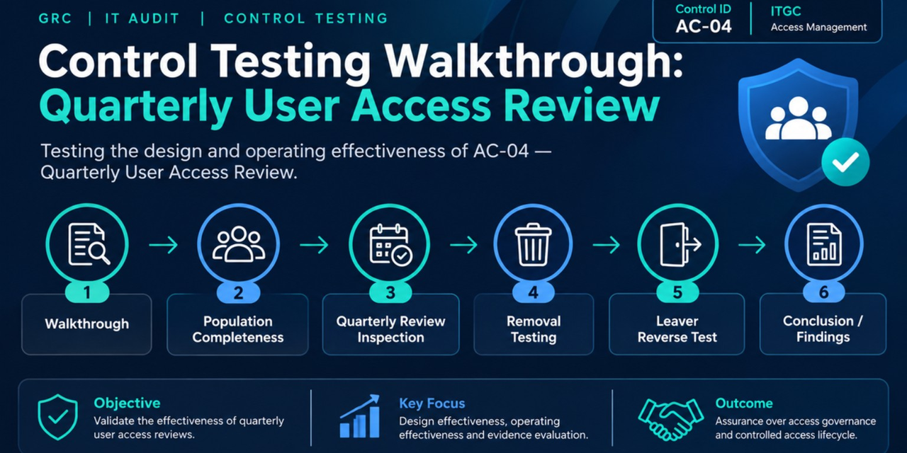

# Control Testing Walkthrough: Quarterly User Access Review

**Author:** David Ogunrinola | **Date:** November 2026
**Area:** IT General Controls (Logical Access) | **Type:** Control testing walkthrough

> **Disclaimer:** This is a portfolio exercise. Brightwave Microfinance Ltd is a fictional company and all data, names, and results are simulated to demonstrate testing methodology.

---

## 1. Overview

This project walks through how I would test a **periodic user access review** control from design evaluation through operating effectiveness testing, evidence evaluation, and a final conclusion with findings.

**Why this control?** Access reviews are one of the most commonly tested ITGCs in SOX, ISO 27001, and SOC 2 audits. They are the main detective control against privilege creep, orphaned accounts, and leavers who keep access.

## 2. Scenario

**Brightwave Microfinance Ltd** is a mid-sized Nigerian lender (~300 staff). Its core lending platform, **LoanCore**, processes loan disbursements and repayments, and feeds the financial statements.

| Item | Detail |
|---|---|
| System in scope | LoanCore (core lending application) |
| Control owner | IT Security Manager |
| Control reviewers | System/business owners (Lending Ops, Finance, IT) |
| Period tested | Q1 to Q3 2026 (1 Jan to 30 Sep) |
| User population | 142 active accounts at 30 Sep 2026 (including 11 privileged and service accounts) |

## 3. Control Being Tested

**Control ID:** AC-04 | **Type:** Detective, manual | **Frequency:** Quarterly

> Each quarter, the IT Security Manager extracts a complete list of LoanCore user accounts and their roles. System owners review the list, confirm each user's access is appropriate, and sign off within **15 business days**. Any access flagged for removal or change is actioned within **5 business days**, and evidence is retained.

**Why it matters (risk addressed):**
- Terminated or transferred staff retaining access (unauthorized access)
- Excessive privileges enabling segregation of duties (SoD) conflicts, for example one user able to create and approve a loan
- Unmonitored privileged and service accounts being misused

**Framework mapping:**

| Framework | Reference |
|---|---|
| ISO/IEC 27001:2022 | A.5.15 Access control, A.5.18 Access rights, A.8.2 Privileged access rights |
| NIST SP 800-53 Rev. 5 | AC-2 Account Management |
| SOX / COSO ITGC | Logical access: user access reviews |

## 4. Test Objective and Scope

**Objective:** Determine whether control AC-04 is suitably designed and operated effectively throughout Q1 to Q3 2026.

**In scope:** LoanCore user accounts, including privileged and service accounts.
**Out of scope:** Other applications, infrastructure-level (OS/database) access, access provisioning (tested separately).

## 5. Testing Methodology

| Step | Procedure | Purpose |
|---|---|---|
| 1 | **Walkthrough** with the control owner; obtain the access review procedure and a sample of the review package | Understand and evaluate design |
| 2 | **Completeness and accuracy of the user listing (IPE)**: compare the user list used in the review to a system-generated list pulled independently | Confirm reviewers saw the full population |
| 3 | **Inspect each quarterly review** (Q1, Q2, Q3): reviewer sign-off, reviewer appropriateness, timeliness (15 business days) | Test operating effectiveness |
| 4 | **Trace removals**: for every access flagged for removal, confirm it was actioned within 5 business days | Confirm the review leads to action |
| 5 | **Reverse test (leavers)**: compare HR termination list to active LoanCore accounts | Detect gaps the review should have caught |
| 6 | **Evaluate results** against tolerance (zero exceptions for key control attributes) and conclude | Form conclusion |

**Sampling approach:** The control occurs 3 times in the period, so all 3 occurrences were tested (100%). For removals and leavers, the full population was tested.

## 6. Evidence Requested and How I Evaluate It

| Evidence | What I look for | Red flags |
|---|---|---|
| Access review procedure | Defined owner, frequency, deadline, escalation | Vague ownership, no deadline |
| User list extracted for review | Generated by system, dated, includes roles | Manual or edited spreadsheets, missing accounts |
| Independent system user list | Matches the review list | Account count mismatch |
| Signed review package per quarter | Dated sign-off by an appropriate owner, decisions per user | Rubber-stamping, sign-off by IT instead of the business owner |
| Removal tickets / change logs | Closure dates within SLA | Closed without system evidence |
| HR leavers list vs active accounts | No leavers with active access | Active accounts after termination date |

## 7. Test Results (Simulated)

### 7.1 Design evaluation
The control is clearly owned, has a defined frequency, and requires business-owner sign-off. **Design gap:** the procedure does not explicitly require the extracted list to be validated against the system, and does not name privileged or service accounts as in scope.

### 7.2 Operating effectiveness

| Test | Q1 | Q2 | Q3 | Result |
|---|---|---|---|---|
| Review performed and signed by appropriate owner | Yes | Yes | Yes | Pass |
| Completed within 15 business days | 12 days | **22 days** | 14 days | **Exception (Q2)** |
| User list complete vs system | 131 / 131 | 135 / 135 | **131 / 142** | **Exception (Q3)** |
| Removals actioned within 5 business days | 6 / 6 | 4 / 4 | **7 / 9** | **Exception (Q3)** |

**Q3 completeness detail:** The review list contained 131 accounts against 142 in the system. The 11 missing accounts were all privileged or service accounts, which are excluded by the extraction query.

**Q3 removals detail:** 2 of 9 removals were completed in 19 and 21 business days respectively. Both related to Finance users with approval rights.

### 7.3 Reverse test: leavers

14 employees left the company during the period. **2 of 14** still had active LoanCore accounts at 30 Sep 2026 (terminated 34 and 61 days earlier). Neither had logged in after termination, based on the login history reviewed.

## 8. Findings

### Finding 1: Privileged and service accounts excluded from access review (High)

| | |
|---|---|
| **Condition** | 11 privileged and service accounts were excluded from the Q3 review population due to the extraction query filter. |
| **Criteria** | ISO 27001 A.8.2 and NIST AC-2 require review of privileged access; internal policy requires all accounts in scope. |
| **Cause** | Procedure does not define privileged and service accounts as in scope, and the user list is not validated for completeness. |
| **Impact** | Highest-risk accounts go unreviewed, increasing the risk of unauthorized or inappropriate privileged access going undetected. |
| **Recommendation** | Update the extraction query and procedure to include all account types, and add a completeness check (system count vs review count) before distribution. |

### Finding 2: Removals and leaver access not removed in a timely manner (Medium)

| | |
|---|---|
| **Condition** | 2 of 9 Q3 removals exceeded the 5-day SLA; 2 of 14 leavers retained active access up to 61 days. |
| **Criteria** | Access removal within 5 business days of review decision; leavers disabled on or before last working day. |
| **Cause** | No automated link between HR terminations and LoanCore, and no tracking of removal tickets to closure. |
| **Impact** | Elevated risk of unauthorized access, particularly with Finance approval rights. |
| **Recommendation** | Integrate HR leaver notifications with access deprovisioning, and have Security track removal tickets to closure with escalation after 5 days. |

### Finding 3: Q2 review completed late (Low)

| | |
|---|---|
| **Condition** | Q2 review completed in 22 business days against a 15-day deadline. |
| **Criteria** | Control AC-04 requires completion within 15 business days. |
| **Cause** | No escalation process for overdue reviewers. |
| **Impact** | Delayed detection of inappropriate access. |
| **Recommendation** | Add reminders at day 10 and escalation to department heads at day 15. |

## 9. Conclusion

| Assessment | Rating |
|---|---|
| Design effectiveness | **Partially effective**: owner, frequency, and sign-off defined, but no completeness validation and unclear scope |
| Operating effectiveness | **Not effective**: exceptions in completeness, timeliness, and removal follow-through |
| Overall | **Control deficiency (significant)**: remediation recommended before the next review cycle |

Because the exceptions affect privileged accounts and Finance approval access, I would consider the deficiency significant. In a SOX context I would also assess whether compensating controls (for example transaction monitoring or SoD reports) reduce the risk before deciding on final classification.

## 10. Skills Demonstrated

- Control design and operating effectiveness testing
- Evidence evaluation and IPE (completeness and accuracy) testing
- Reverse testing and sampling decisions
- Control mapping to ISO 27001, NIST 800-53, and SOX ITGC
- Audit finding structure: condition, criteria, cause, impact, recommendation

---

*Part of my GRC portfolio. Feedback welcome.*
